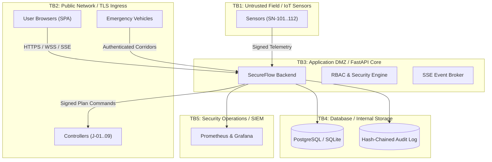

# Phase 1: Requirements & Security Objectives Specification

**Course**: 24CYS401 - Secure Software Engineering  
**System**: SecureFlow - Smart City Traffic Management System  
**Canonical Reference**: `docs/00-canonical-facts.md`

---

## 1. System Overview & Context
SecureFlow is a resilient, cyber-physical traffic control platform designed for urban smart city infrastructure. It ingests high-velocity IoT telemetry from roadside sensors, dynamically calculates congestion levels, arbitrates split-cycle traffic light plans via a two-person approval workflow, and orchestrates priority green corridors for emergency response vehicles.

---

## 2. Functional Requirements (FR-01 to FR-08)

| ID | Requirement Name | Description | Acceptance Criteria |
|:---|:---|:---|:---|
| **FR-01** | IoT Telemetry Ingestion | Ingest per-sensor vehicular volume, average speed, and lane occupancy at 10-second intervals. | Ingests JSON payload with sensor ID, junction ID, volume, speed, occupancy, nonce, timestamp, and HMAC-SHA256 signature. |
| **FR-02** | Congestion State Classification | Continuously evaluate junction occupancy using a dynamic strategy pattern. | Classify into Low (<35%), Moderate (35-60%), High (60-80%), and Severe (>=80%). Triggers critical alerts on severe transitions. |
| **FR-03** | Adaptive Signal Plan Control | Allow operators to propose signal phase adjustments within bounded safety envelopes. | Signal adjustments enforce green (10–120s), amber (3–5s), all-red (1–5s), and total cycle time (<=240s). |
| **FR-04** | Two-Person Signal Approval | Require strict supervisory approval before activating timing adjustments. | The proposing operator cannot approve their own change. Approved plans are HMAC-signed and dispatched to intersection controllers. |
| **FR-05** | Emergency Green Corridors | Clear transit routes across multiple junctions for emergency vehicles. | Computes shortest path via BFS graph traversal, locks green lights along route for 60–300s, max 3 requests per vehicle per 10 min. |
| **FR-06** | Incident & Alert Lifecycle | Coordinate field disruptions, accidents, and hardware anomalies. | Manage state transitions (`OPEN` -> `INVESTIGATING` -> `RESOLVED` -> `CLOSED`). Closure restricted to supervisor role. |
| **FR-07** | Traffic Analytics & Reporting | Provide historical congestion trends and aggregated metrics. | Hourly aggregations with whitelisted date ranges (24h, 7d, 30d) and sanitised CSV export. |
| **FR-08** | Real-Time Dashboard & SSE | Stream live system state, phase states, and alerts to connected clients. | Dispatches real-time events over Server-Sent Events without polling. |

---

## 3. Security Requirements (SR-01 to SR-09)

| ID | Security Requirement | Technical Mechanism | Verification Method |
|:---|:---|:---|:---|
| **SR-01** | Authentication & Lockout | Argon2id password hashing, 5 failed attempts lockout, TOTP MFA for supervisor and admin. | `tests/test_api_auth.py`, `tests/test_auth_matrix.py` |
| **SR-02** | Sensor HMAC Authentication | Field sensors sign telemetry with pre-shared device secrets using HMAC-SHA256. Unregistered devices rejected. | `tests/test_crypto.py`, `tests/test_integration_telemetry.py` |
| **SR-03** | Telemetry Anti-Replay | Single-use nonces cached with 60s TTL; timestamp freshness window strictly +/-30s. | `tests/test_nonce.py` |
| **SR-04** | Plausibility & Anomaly Filtering | Verify physical limits (speed <=160 km/h, volume <=120 veh/min, occupancy <=100%) and neighbor consistency. | `tests/test_plausibility.py` |
| **SR-05** | Centralized RBAC Enforcement | Central FastAPI dependency enforcing the exact `PERMS` table. Deny by default. | `tests/test_rbac.py`, `tests/test_auth_matrix.py` |
| **SR-06** | Two-Person Dual Control | Proposer ID check against current user ID during signal approval endpoint. | `tests/test_e2e_signal_flow.py` |
| **SR-07** | Tamper-Evident Audit Logging | Append-only hash chain ($H_n = \text{SHA256}(H_{n-1} \parallel \text{Entry}_n)$) with verification endpoint. | `tests/test_audit.py` |
| **SR-08** | Injection & XSS Defense | Parameterized SQLAlchemy queries, formula injection neutralization in CSV exports, strict CSP without `unsafe-inline`. | `tests/test_sqli.py`, `tests/test_xss_escaping.py` |
| **SR-09** | Rate Limiting & DoS Shield | SlowAPI client-IP rate limiting (100 req/min general, 10 req/min auth) and memory-bounded queues. | `tests/test_auth_matrix.py` |

---

## 4. Non-Functional Requirements (NFR-01 to NFR-02)

- **NFR-01 (Performance & Latency)**:
  - Telemetry ingestion processing latency $\le 50\text{ ms}$ at 99th percentile.
  - SSE update broadcast propagation $\le 100\text{ ms}$ from event trigger.
  - Signal safety validation execution $\le 10\text{ ms}$.
- **NFR-02 (Maintainability & Zero-Trust Architecture)**:
  - Zero external CDN dependencies at runtime (all vendor scripts and fonts self-hosted).
  - Memory-only JWT access tokens and HttpOnly, Secure, SameSite=Strict refresh cookies.
  - Minimum 80% automated test coverage across all layers (achieved **86%**).
