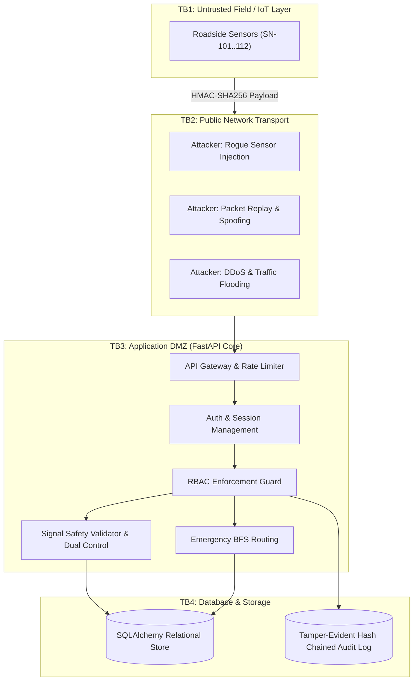

# Phase 2: Threat Modeling & STRIDE Matrix Specification

**Course**: 24CYS401 - Secure Software Engineering  
**System**: SecureFlow - Smart City Traffic Management System  
**Canonical Reference**: `docs/00-canonical-facts.md`

---

## 1. Trust Boundaries & Attack Surfaces



---

## 2. STRIDE Threat Categorization & Mitigations

| Category | Threat Focus | System Impact | Mitigating Control |
|:---|:---|:---|:---|
| **S** - Spoofing | Attacker impersonates field sensor or dispatcher | False congestion reports, unauthorized green corridors | Per-device HMAC-SHA256 signing, strict status check (`ACTIVE`), vehicle role verification |
| **T** - Tampering | Interception and modification of telemetry or plan payloads | Dangerous signal timing plans, corrupted audit trail | HMAC signature verification, strict bounds validation (`SAFE` constants), SHA-256 hash chaining |
| **R** - Repudiation | Operator denies proposing or supervisor denies approving changes | Inability to audit security anomalies or trace accidents | Dual-person audit logs with operator IDs, IP tracing, cryptographically signed apply events |
| **I** - Information Disclosure | Interception of API tokens, device secrets, or credentials | Credential harvesting, system takeover | Memory-only access tokens, HttpOnly/Secure refresh cookies, Argon2id hashing, encrypted/hashed device secrets |
| **D** - Denial of Service | Telemetry floods, signal change storms, brute force | Crash of traffic arbitration, system lockups | SlowAPI rate limiting (IP & user tier), bounded async queues, nonce TTL eviction |
| **E** - Elevation of Privilege | Operator attempts to approve their own signal change | Circumvention of safety controls, collision risks | Deny-by-default RBAC dependency, explicit `proposer_id != approver_id` constraint |

---

## 3. Canonical Threat Catalog & DREAD Risk Scoring (THR-01 to THR-13)

| ID | Threat Description | D | R | E | A | D | Total | Risk Level | Defense Mechanism | Test Verification |
|:---|:---|:---:|:---:|:---:|:---:|:---:|:---:|:---:|:---|:---|
| **THR-01** | Unregistered / Revoked Device Ingestion | 7 | 8 | 8 | 8 | 8 | 39 | **High** | Sensor lookup against database; reject unregistered or `REVOKED` IDs with HTTP 401 | `test_integration_telemetry.py` |
| **THR-02** | Implausible Telemetry Injection | 8 | 7 | 6 | 8 | 8 | 37 | **High** | Physical bounds check (Speed $\le 160$, Volume $\le 120$) & jump delta check | `test_plausibility.py` |
| **THR-03** | Telemetry Packet Replay Attack | 7 | 8 | 7 | 8 | 8 | 38 | **High** | 60s TTL nonce deduplication & $\pm 30\text{s}$ timestamp freshness window | `test_nonce.py` |
| **THR-04** | Direct Plan Application (Bypass Approval) | 9 | 9 | 8 | 7 | 9 | 42 | **Critical** | Plans require `APPROVED` state transition before dispatch; controllers verify HMAC | `test_e2e_signal_flow.py` |
| **THR-05** | Unauthorized Role Escalation (RBAC Bypass) | 9 | 9 | 9 | 7 | 9 | 43 | **Critical** | Central `require_permission` dependency; self-role modification prohibited | `test_rbac.py` |
| **THR-06** | Telemetry / API Flood (DoS) | 6 | 7 | 8 | 9 | 7 | 37 | **High** | SlowAPI rate limiter (100 req/min general, 10 req/min auth) | `test_auth_matrix.py` |
| **THR-07** | Sensor Signal Hijack via Stolen Shared Key | 8 | 8 | 8 | 6 | 7 | 37 | **High** | Secret key shown once upon registration; stored as salted hash in DB; instant revocation | `test_crypto.py` |
| **THR-08** | Timing Safety Inversion (Invalid Cycle Times) | 9 | 8 | 8 | 6 | 9 | 40 | **Critical** | Server-side validation of `SAFE` limits ($G \in [10, 120]$, $A \in [3, 5]$, $R \in [1, 5]$, $\Sigma \le 240$) | `test_signal_validation.py` |
| **THR-09** | Dual-Person Self-Approval Attack | 9 | 8 | 8 | 7 | 9 | 41 | **Critical** | Proposer ID compared against approver ID; HTTP 403 on match | `test_e2e_signal_flow.py` |
| **THR-10** | Forged Emergency Green Corridor | 8 | 8 | 8 | 7 | 8 | 39 | **High** | Dedicated `emergency.create` permission check, vehicle rate limit (max 3/10m), auto-expiry | `test_e2e_emergency.py` |
| **THR-11** | Audit Log History Tampering | 8 | 7 | 7 | 5 | 8 | 35 | **High** | SHA-256 hash chaining ($H_n = \text{SHA256}(H_{n-1} \parallel \text{Entry}_n)$); `/api/audit/verify` detection | `test_audit.py` |
| **THR-12** | SQL & CSV Formula Injection Attack | 8 | 8 | 9 | 7 | 8 | 40 | **Critical** | Parameterized queries via SQLAlchemy; prefix `=,+,-,@` characters with `'` in CSV | `test_sqli.py` |
| **THR-13** | Cross-Site Scripting (Stored / DOM XSS) | 8 | 7 | 8 | 8 | 8 | 39 | **High** | Mandatory `esc()` escaping on dynamic data; strict CSP with `script-src 'self'` | `test_xss_escaping.py` |

---

## 4. Attack Trees for Critical Threats

### Attack Tree 1: Unauthorized Signal Manipulation (THR-04 / THR-09)
```
[Goal: Force Unauthorized Green Signal at Target Intersection]
  ├── 1. Exploit Direct Application Endpoint
  │     ├── 1.1 Direct POST to controller (Mitigated: Controller requires server HMAC signature)
  │     └── 1.2 Bypass status transition (Mitigated: Server enforces PROPOSED -> APPROVED -> APPLIED)
  └── 2. Circumvent Dual-Person Rule
        ├── 2.1 Proposer attempts self-approval (Mitigated: Enforced proposer_id != approver_id)
        └── 2.2 Compromise supervisor account (Mitigated: TOTP MFA required for supervisor logins)
```

### Attack Tree 2: Telemetry Manipulation & Congestion Spoofing (THR-01 / THR-02 / THR-03)
```
[Goal: Inject False Congestion to Cause Gridlock or Trigger Malicious Alerts]
  ├── 1. Replay Legitimate Rush-Hour Packets (Mitigated: Nonce cache + 30s freshness window)
  ├── 2. Forge Telemetry with Arbitrary Sensor ID (Mitigated: HMAC-SHA256 device key verification)
  └── 3. Send Out-of-Bounds Sensor Values (Mitigated: Plausibility filter & jump delta validation)
```
