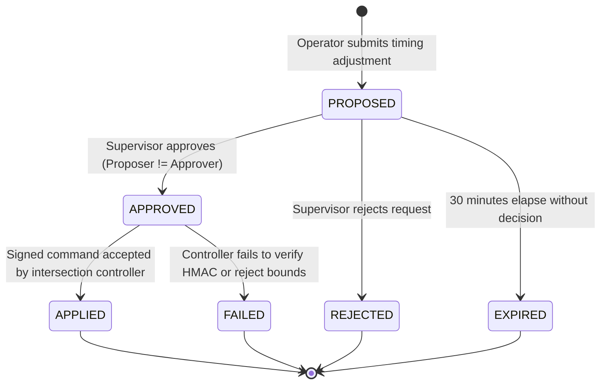

# Phase 3: Security Architecture & Cryptographic Design

**Course**: 24CYS401 - Secure Software Engineering  
**System**: SecureFlow - Smart City Traffic Management System  
**Canonical Reference**: `docs/00-canonical-facts.md`

---

## 1. System Architecture & Component Interactions

```mermaid
graph TB
    subgraph Client["Presentation Layer (Client Browser)"]
        UI["SPA Views (HTML5/CSS/ES Modules)"]
        State["State Manager (Memory Token)"]
        SSEListener["SSE Stream Consumer"]
    end

    subgraph SecurityShield["Security & Ingress Layer"]
        Middleware["Security Headers / Strict CSP / CSRF Guard"]
        RateLimiter["SlowAPI Rate Limiter"]
        RBACFilter["Central RBAC Dependency"]
    end

    subgraph CoreServices["Application Services Layer"]
        AuthSvc["Auth & TOTP Service"]
        TelemetrySvc["Telemetry Ingestion & Anomaly Detector"]
        SignalSvc["Signal Control & Dual-Person Engine"]
        CorridorSvc["Emergency Corridor BFS Engine"]
        IncidentSvc["Incident & Alert Lifecycle Service"]
        AuditSvc["Hash-Chained Audit Ledger"]
        Broker["SSE Event Dispatcher"]
    end

    subgraph HardwareSim["Field Simulators & Persistence"]
        DB[(PostgreSQL / SQLite Database)]
        ControllerSim["Intersection Controllers (J-01..09)"]
        SensorSim["IoT Sensors (SN-101..112)"]
    end

    UI <--> State
    UI <--> SSEListener
    State -->|HTTP / JSON + Auth Bearer| Middleware
    Middleware --> RateLimiter --> RBACFilter
    RBACFilter --> AuthSvc
    RBACFilter --> TelemetrySvc
    RBACFilter --> SignalSvc
    RBACFilter --> CorridorSvc
    RBACFilter --> IncidentSvc
    RBACFilter --> AuditSvc
    TelemetrySvc --> Broker
    SignalSvc --> Broker
    CorridorSvc --> Broker
    IncidentSvc --> Broker
    Broker -->|SSE Stream| SSEListener
    AuthSvc & TelemetrySvc & SignalSvc & CorridorSvc & IncidentSvc & AuditSvc <--> DB
    TelemetrySvc <--|Signed Ingest| SensorSim
    SignalSvc -->|Signed Apply| ControllerSim
```

---

## 2. Role-Based Access Control (RBAC) Matrix

The backend enforces the central `PERMS` table with a deny-by-default architecture:

| Permission String | Operator | Supervisor | Admin | Analyst | Auditor | Emergency Dispatcher | Sensor (Device) |
|:---|:---:|:---:|:---:|:---:|:---:|:---:|:---:|
| `dashboard.view` | ✅ | ✅ | ✅ | ✅ | ✅ | ✅ | ❌ |
| `signal.view` | ✅ | ✅ | ✅ | ✅ | ✅ | ❌ | ❌ |
| `signal.propose` | ✅ | ✅ | ❌ | ❌ | ❌ | ❌ | ❌ |
| `signal.approve` | ❌ | ✅ | ❌ | ❌ | ❌ | ❌ | ❌ |
| `emergency.view` | ✅ | ✅ | ✅ | ❌ | ❌ | ✅ | ❌ |
| `emergency.create`| ❌ | ❌ | ❌ | ❌ | ❌ | ✅ | ❌ |
| `emergency.cancel`| ❌ | ✅ | ❌ | ❌ | ❌ | ✅ | ❌ |
| `incident.view` | ✅ | ✅ | ✅ | ✅ | ✅ | ✅ | ❌ |
| `incident.manage` | ✅ | ✅ | ❌ | ❌ | ❌ | ❌ | ❌ |
| `incident.close` | ❌ | ✅ | ❌ | ❌ | ❌ | ❌ | ❌ |
| `alert.view` | ✅ | ✅ | ✅ | ❌ | ✅ | ❌ | ❌ |
| `alert.ack` | ✅ | ✅ | ✅ | ❌ | ❌ | ❌ | ❌ |
| `sensors.view` | ✅ | ✅ | ✅ | ✅ | ✅ | ❌ | ❌ |
| `sensors.manage` | ❌ | ❌ | ✅ | ❌ | ❌ | ❌ | ❌ |
| `users.manage` | ❌ | ❌ | ✅ | ❌ | ❌ | ❌ | ❌ |
| `audit.view` | ❌ | ❌ | ✅ | ❌ | ✅ | ❌ | ❌ |
| `analytics.view` | ❌ | ❌ | ❌ | ✅ | ❌ | ❌ | ❌ |
| `security.view` | ❌ | ✅ | ✅ | ❌ | ✅ | ❌ | ❌ |
| `security.simulate`| ❌ | ✅ | ✅ | ❌ | ❌ | ❌ | ❌ |
| `telemetry.ingest`| ❌ | ❌ | ❌ | ❌ | ❌ | ❌ | ✅ |

---

## 3. Cryptographic Protocols & Security Mechanisms

### A. Password Hashing
- **Algorithm**: Argon2id (`argon2-cffi`)
- **Parameters**: `time_cost=3`, `memory_cost=65536` (64 MB), `parallelism=4`, salt length 16 bytes.
- **Lockout Policy**: 5 consecutive failed authentication attempts lock account; unlock requires administrator intervention (`PATCH /api/admin/users/{id}`).

### B. Session & Token Management
- **Access Token**: Short-lived (15 minutes) signed JSON Web Token (`HS256`), held strictly in client JavaScript memory.
- **Refresh Token**: Long-lived (8 hours) stored in an `HttpOnly`, `Secure`, `SameSite=Strict` cookie (`secureflow_refresh`).
- **Token Rotation**: Every refresh request generates a new refresh token and invalidates the previous token.
- **CSRF Defense**: Double-submit cookie with custom header `X-CSRF-Token` verified on all mutating cookie-authenticated endpoints.

### C. Sensor Telemetry Integrity (HMAC-SHA256)
- **Signature Schema**:
  $$\text{HMAC-SHA256}_{K_{\text{device}}}\left( \text{sensor\_id} \parallel \text{junction\_id} \parallel \text{vehicle\_count} \parallel \text{avg\_speed} \parallel \text{occupancy} \parallel \text{timestamp} \parallel \text{nonce} \right)$$
- **Anti-Replay Window**:
  - $|T_{\text{server}} - T_{\text{reading}}| \le 30\text{ seconds}$.
  - Nonces cached in-memory with automatic TTL expiration (60 seconds). Duplicate nonces within the window trigger HTTP 401 and an audit alert.

### D. Tamper-Evident Hash Chained Audit Ledger
- **Append-Only Construction**:
  $$H_0 = \text{SHA-256}(\text{"GENESIS"})$$
  $$H_n = \text{SHA-256}(H_{n-1} \parallel \text{timestamp} \parallel \text{action} \parallel \text{actor\_id} \parallel \text{target\_id} \parallel \text{details\_json})$$
- **Verification**: `/api/audit/verify` iterates through all entries sequentially, recomputing $H_n$ from $H_{n-1}$ and entry metadata. Any discrepancy immediately reports `valid: false` with the exact corrupt sequence ID.

---

## 4. Signal Control State Machine & Safety Constraints



### Safety Constraints Envelope (`SAFE`)
- **Green Phase Time**: $10\text{ s} \le t_{\text{green}} \le 120\text{ s}$
- **Amber Phase Time**: $3\text{ s} \le t_{\text{amber}} \le 5\text{ s}$
- **All-Red Clearance Time**: $1\text{ s} \le t_{\text{all-red}} \le 5\text{ s}$
- **Total Split-Cycle Time**: $\sum (t_{\text{green}} + t_{\text{amber}} + t_{\text{all-red}}) \le 240\text{ s}$
- **Two-Person Rule**: $\text{Proposer ID} \ne \text{Approver ID}$
