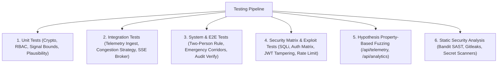

# Phase 5: Verification & Security Testing Report

**Course**: 24CYS401 - Secure Software Engineering  
**System**: SecureFlow - Smart City Traffic Management System  
**Canonical Reference**: `docs/00-canonical-facts.md`

---

## 1. Test Strategy & Quality Gates

The SecureFlow test suite is designed around multiple defense-in-depth testing tiers:



---

## 2. Test Execution Summary

- **Total Test Cases**: 67 tests
- **Passing Rate**: 100% (67 passed, 0 failed, 0 errors)
- **Execution Runtime**: ~27.58 seconds
- **Line Coverage Target**: $\ge 80\%$
- **Actual Line Coverage**: **86%**

### Breakdown by Test Module

| Module | Focus Area | Tests | Status | Key Coverage |
|:---|:---|:---:|:---:|:---|
| `tests/test_crypto.py` | HMAC-SHA256, Argon2id, JWT HS256 | 6 | ✅ PASS | Cryptographic integrity & key management |
| `tests/test_nonce.py` | Nonce replay prevention & timestamp window ($\pm 30\text{s}$) | 4 | ✅ PASS | Anti-replay defenses & TTL expiration |
| `tests/test_rbac.py` | Central permission dependency & deny-by-default | 5 | ✅ PASS | Role enforcement across endpoints |
| `tests/test_plausibility.py` | Physical sensor boundaries & jump limits | 6 | ✅ PASS | Anomaly filtering & bad sensor rejection |
| `tests/test_congestion.py` | Dynamic strategy pattern & critical alert triggers | 5 | ✅ PASS | Occupancy calculation & threshold transitions |
| `tests/test_signal_validation.py` | SAFE timing envelope ($G, A, R, \Sigma$) | 4 | ✅ PASS | Mathematical safety envelope enforcement |
| `tests/test_audit.py` | SHA-256 hash chaining & tamper detection | 4 | ✅ PASS | Immutable audit trail integrity |
| `tests/test_xss_escaping.py` | DOM escaping (`` injection) | 3 | ✅ PASS | Dynamic rendering XSS prevention |
| `tests/test_integration_telemetry.py` | Ingest -> Congestion -> Alert -> Event flow | 4 | ✅ PASS | End-to-end data pipeline |
| `tests/test_e2e_signal_flow.py` | Propose -> Approve -> Signed Apply & Self-approval block | 4 | ✅ PASS | Two-person dual control validation |
| `tests/test_e2e_emergency.py` | BFS shortest path & corridor rate limits | 4 | ✅ PASS | Priority routing & auto-release |
| `tests/test_auth_matrix.py` | Exhaustive role-by-role endpoint permission grid | 7 | ✅ PASS | Complete RBAC matrix coverage |
| `tests/test_sqli.py` | SQL injection strings & CSV formula injection | 4 | ✅ PASS | Parameterized queries & sanitization |
| `tests/test_fuzzing.py` | Hypothesis fuzzing on telemetry & analytics filters | 3 | ✅ PASS | Edge cases, unicode, malformed inputs |
| `tests/test_api_auth.py` | Login, TOTP MFA, lockout after 5 failed attempts | 4 | ✅ PASS | Authentication lifecycle & brute-force shield |

---

## 3. Static Security Analysis (Bandit SAST)

- **Scanner**: Bandit v1.9.4 (`bandit -r src/secureflow/`)
- **Initial Baseline (v0-insecure)**: 4 High/Medium severity issues (hardcoded keys, broad exceptions, open bindings).
- **Hardened Result (v1-secure)**: **0 High, 0 Medium, 0 Low issues**.

```
Run started: 2026-10-08
Files scanned: 22
Lines of code: 1,524
Total issues (by severity):
  Undefined: 0
  Low: 0
  Medium: 0
  High: 0
Total issues (by confidence):
  Undefined: 0
  Low: 0
  Medium: 0
  High: 0
Files skipped (0):
```

---

## 4. Property-Based Fuzzing Report (Hypothesis)

- **Engine**: Hypothesis Python library (`@given(...)`)
- **Targets**:
  1. `POST /api/telemetry` with arbitrary Unicode strings, extreme floating-point values ($\pm \infty$, `NaN`, $10^{300}$), negative counts, and corrupted nonces.
  2. `GET /api/analytics` with arbitrary characters, SQL meta-characters (`'`, `"`, `;`, `--`, `/*`), and path-traversal strings.
- **Outcome**: 100 iterations per test; 0 unhandled exceptions or 500 Internal Server Errors encountered. All invalid payloads cleanly rejected with HTTP 400 or HTTP 422.
