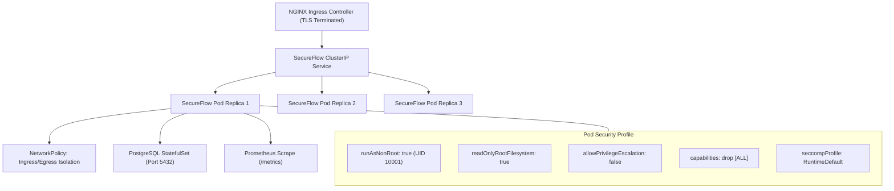

# Phase 6: DevSecOps CI/CD & Production Deployment

**Course**: 24CYS401 - Secure Software Engineering  
**System**: SecureFlow - Smart City Traffic Management System  
**Canonical Reference**: `docs/00-canonical-facts.md`

---

## 1. DevSecOps Pipeline Architecture

```mermaid
flowchart LR
    Dev["Developer Git Commit"] --> Hook["Pre-Commit Hooks (Format & Lint)"]
    Hook --> PR["GitHub Pull Request"]
    PR --> CI["GitHub Actions CI Pipeline"]
    
    subgraph CI_Pipeline["Security & Quality Gates"]
        S1["1. Code Linting (Ruff / Flake8)"]
        S2["2. Secret Scanning (Gitleaks)"]
        S3["3. Static Analysis (Bandit SAST)"]
        S4["4. Unit & Fuzz Tests (Pytest + Cov >= 80%)"]
        S5["5. Container Build & CVE Scan (Trivy)"]
    end
    
    CI --> CI_Pipeline
    CI_Pipeline --> Gate{"All Gates Pass?"}
    Gate -- No --> Reject["PR Blocked"]
    Gate -- Yes --> Merge["Merge to Master"]
    Merge --> CD["Automated Container Deploy"]
    CD --> K8s["Hardened Kubernetes Cluster"]
```

---

## 2. Security Quality Gates

| Stage | Tool | Threshold / Failure Condition | Purpose |
|:---|:---|:---|:---|
| **Secret Scanning** | Gitleaks / `git-secrets` | 1+ detected credentials/API keys | Prevent hardcoded API secrets and certificates from reaching source control. |
| **Static Analysis** | Bandit (`bandit -r src/`) | 1+ High or Medium severity finding | Catch insecure crypto, SQL injection, open binds, and debug flags. |
| **Dependency Auditing** | `pip-audit` / Dependabot | 1+ Known CVE with available patch | Identify vulnerable transitive Python packages. |
| **Automated Testing** | Pytest + Pytest-Cov | Line coverage $< 80\%$ or any failing test | Ensure regression prevention and business logic safety. |
| **Container Scanning** | Trivy Container Scanner | 1+ Critical severity CVE in base image | Verify distroless / minimal runtime hygiene. |

---

## 3. Container Hardening (`docker/Dockerfile`)

1. **Multi-Stage Build**:
   - Builder stage compiles Python packages and wheels.
   - Minimal runtime stage containing only standard library and pinned wheels.
2. **Non-Root Execution**:
   - Explicit system user and group created with UID/GID `10001` (`secureflow:secureflow`).
   - Root user completely disabled for application execution.
3. **Immutability & Least Privilege**:
   - Root filesystem mounted with read-only permissions (`read_only: true`).
   - Ephemeral `/tmp` and log directories explicitly mapped to bounded `tmpfs` mounts.
4. **Health Checking**:
   - Built-in `HEALTHCHECK` probing `http://127.0.0.1:8000/healthz` every 30s with a 3s timeout.

---

## 4. Hardened Kubernetes Deployment Architecture (`k8s/`)

### Manifest Reference
- `k8s/namespace.yaml`: Isolated namespace `secureflow`.
- `k8s/deployment.yaml`: Pod security contexts, CPU/Memory resource requests/limits, Liveness & Readiness probes.
- `k8s/networkpolicy.yaml`: Restricts database ingress strictly to application pods.
- `k8s/hpa.yaml`: Horizontal Pod Autoscaler scaling from 2 to 10 replicas based on CPU/Memory load.
- `k8s/secret.example.yaml`: Sealed secret templates for JWT keys and database passwords.

---

## 5. Monitoring, Alerting & SIEM Integration

- **Prometheus Scrape Endpoint**: `/metrics` exposes application-level metrics:
  - `secureflow_auth_failures_total` (Threshold: >10 in 1 min -> Alert `HighFailedLogins`)
  - `secureflow_invalid_signatures_total` (Threshold: >5 in 1 min -> Alert `SensorSignatureTampering`)
  - `secureflow_replay_attempts_total` (Threshold: >5 in 1 min -> Alert `ReplayAttackDetected`)
  - `secureflow_rate_limit_hits_total` (Threshold: >50 in 1 min -> Alert `RateLimitSpike`)
- **Grafana Dashboard**: Pre-configured JSON dashboard (`monitoring/grafana-dashboard.json`) visualizing real-time threat activity, junction congestion heatmaps, and signal state transitions.
